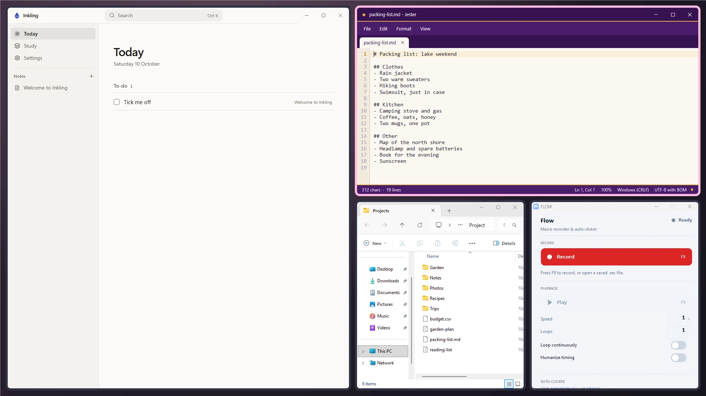

# Mochi

[](https://github.com/dominikkoenitzer/Mochi/actions/workflows/ci.yml)

A tiling window manager for Windows, written in Rust: it arranges every open
window into tiles that you focus, move and resize from the keyboard.



## Download

[Download Mochi](https://portfolio-izanagi.vercel.app/projects/mochi),
then double-click it.

Know the way out before you click Install. The moment Mochi starts, every window
on screen is rearranged into tiles. `Pause` turns tiling off and on again, or
`alt + f12` on a keyboard without a Pause key. `alt + shift + e` stops Mochi and
puts every window back. To start it again, open Mochi from the Start menu or run
`mochic start`.

Windows may say "Windows protected your PC"; click More info, then Run anyway.
No admin rights are needed. Setup installs Mochi for your user and starts it,
now and at every login. The PowerShell line and the zip are under
[Other ways to install](docs/install.md).

To update, download and open `Mochi-Setup.exe` again. It stops the running
Mochi first and leaves your settings and hotkeys alone.

## What it does

- Tiles windows in BSP, columns, rows, vertical stack, horizontal stack,
  ultrawide and grid layouts.
- Moves the focus, moves windows and resizes them by direction.
- Gives every monitor its own workspaces, and copes with a screen that is
  unplugged and comes back.
- Floats, maximizes, minimizes or monocles a window, and stacks several windows
  into one tile you cycle through.
- Ignores, floats, manages or places windows by rules on their exe, class,
  title or path.
- Draws window borders and nothing else on screen, and can fade unfocused
  windows and animate moves. Commands turn borders, transparency and
  animations on and off at once, without a reload.
- Binds its own keys, with binding modes, a pause key and a game mode that
  gives a game every key.

The keys the default hotkey file binds:

| Key | Does |
|---|---|
| `alt + h`, `j`, `k`, `l` | Focus left, down, up, right |
| `alt + shift + h`, `j`, `k`, `l` | Move the window left, down, up, right |
| `alt + 1` to `alt + 9` | Switch to that workspace |
| `alt + shift + 1` to `alt + shift + 9` | Move the window to that workspace and follow it |
| `alt + shift + s` | Resize mode: `h`, `j`, `k`, `l` resize, `Esc` leaves |
| `alt + shift + space` | Float the window, or tile it again |
| `alt + shift + q` | Close the window |
| `Pause` or `alt + f12` | Turn tiling off and on |
| `alt + shift + e` | Stop Mochi and put every window back |

The rest of the file and how to change it are under [Hotkeys](docs/hotkeys.md).

## Use it with an AI assistant

`mochic mcp` is an MCP server. An AI assistant that speaks MCP can use it to
see your monitors, workspaces and windows and to arrange them, through the same
local pipe `mochic` uses. Add it to the client's MCP configuration with the full
path to `mochic.exe`:

```json
{
  "mcpServers": {
    "mochi": {
      "command": "C:\\Users\\you\\AppData\\Local\\Programs\\Mochi\\bin\\mochic.exe",
      "args": ["mcp"]
    }
  }
}
```

Replace `you` with your Windows user name. With it, an assistant can:

- read the state: every monitor, workspace and window, and which one has the
  focus;
- say why a window is or is not tiled;
- list the hotkeys, and check `mochi.json` for errors even when Mochi will not
  start;
- focus a window, move one to another workspace, switch workspaces and set the
  layout;
- float a window or put it in monocle, retile, pause and resume tiling, and
  reload the configuration.

Nothing leaves the computer: the server makes no network connection and needs
no account. No tool can stop Mochi, close a window or write
a file. Every tool and what it answers is in [docs/mcp.md](docs/mcp.md).

Without MCP, call `mochic` itself: every command that reports something takes
`--json` and prints one JSON document, on success and on failure, as
[docs/json-output.md](docs/json-output.md) describes.

## Running it from a terminal

Look before you leap. A dry run reads the desktop and changes nothing on it: no
window is moved, cloaked, focused or closed, it takes no control pipe and it
binds no keys, so it is safe to run while another window manager, or another
Mochi, is managing the screen. It only writes its log.

```
mochi --dry-run
```

Every line it prints with `dry-run:` in it is something it would have done. When
that looks right, start it for real, and stop it when you want your desktop
back:

```
mochic start
mochic stop
```

More in [docs/cli.md](docs/cli.md#running-it-from-a-terminal).

## Build from source

On a fresh Windows PC, install Git, rustup and the Microsoft C++ build tools:

```
winget install --id Git.Git -e
winget install --id Rustlang.Rustup -e
winget install --id Microsoft.VisualStudio.2022.BuildTools -e --override "--quiet --wait --norestart --add Microsoft.VisualStudio.Workload.VCTools --includeRecommended"
```

The VCTools workload with its recommended components brings the MSVC linker and
the Windows SDK. Rust on Windows needs both and rustup does not bring them.
Without them the build stops at `error: linker 'link.exe' not found`, which says
nothing about what to go and install.

Open a new terminal so the new PATH is picked up, then:

```
git clone https://github.com/dominikkoenitzer/Mochi
cd Mochi
cargo build --release --locked
```

`rust-toolchain.toml` selects the stable toolchain with rustfmt and clippy, and
rustup fetches it on the first `cargo` call. The oldest Rust that builds Mochi
is 1.96, the `rust-version` in `Cargo.toml`. The first build takes a few
minutes.

Both exes are self-contained: the C runtime is linked in, so they run on any
Windows PC without installing a runtime.

To build `Mochi-Setup.exe` around the two exes you just built, in PowerShell:

```
$env:MOCHI_SETUP_PAYLOAD = "$PWD\target\release"
cargo build --release --locked -p mochi-setup
```

It lands in `target\release\mochi-setup.exe`. Without `MOCHI_SETUP_PAYLOAD` the
setup builds too, but carries nothing and says so when it is opened.

To install what you built:

```
powershell -ExecutionPolicy Bypass -File .\scripts\install.ps1
```

It builds with cargo and installs the same way the one line does, login start
and first start included, and takes the same switches.

`-ExecutionPolicy Bypass` is there because Windows PowerShell 5.1 refuses to run
scripts by default, and a repo downloaded as a zip arrives with every file
marked as coming from the internet. Without it the script fails before it
prints anything, with "running scripts is disabled on this system" or "is not
digitally signed". It changes no setting on the machine, and the same goes for
the other scripts in `scripts\`. The PowerShell line under
[Other ways to install](docs/install.md#powershell) is not affected by execution policy,
because it never runs a script file.

### Tests

The tests are optional, and `cargo test --workspace` touches the desktop you
work in. The `mochi-testbed` tests open real windows and try to move the focus
between them. The `mochi` tests start the built `mochi.exe --dry-run` for about
ten seconds and install global keyboard and window event hooks. None of that
waits for an environment variable. Only the end to end tests, which drive real
windows through the daemon, wait for `MOCHI_E2E`. To run just the tests that
touch no window, leave those two crates out:

```
cargo test --locked -p mochi-core -p mochi-hotkey -p mochi-render -p mochi-client -p mochic
```

### Layout

| Crate | Purpose |
|---|---|
| `mochi-core` | Pure logic: geometry, monitor/workspace/container tree, layouts, rules. No Win32, fully unit tested. |
| `mochi-client` | IPC wire types and the command grammar, shared by the daemon, the CLI and external tools. |
| `mochi-hotkey` | The hotkey file: key names, parsing, lookup. No Win32 either. |
| `mochi-render` | Borders, transparency and animation. |
| `mochi` | The daemon. One thread owns all state and talks to Win32. |
| `mochic` | Command-line client and MCP server. |
| `mochi-setup` | `Mochi-Setup.exe`, which installs and removes Mochi for the current user. |
| `mochi-testbed` | Throwaway windows the end-to-end tests drive. |

## Docs

- [docs/configuration.md](docs/configuration.md): every key in `mochi.json`
- [docs/cli.md](docs/cli.md): every `mochic` command and exit code
- [docs/hotkeys.md](docs/hotkeys.md): the hotkey file
- [docs/json-output.md](docs/json-output.md): `--json` documents
- [docs/mcp.md](docs/mcp.md): the MCP server's tools
- [docs/ipc.md](docs/ipc.md): the pipe protocol between `mochic` and the daemon
- [docs/import.md](docs/import.md): moving an existing setup over
- [docs/install.md](docs/install.md): other ways to install, your data and removing Mochi
- [docs/status.md](docs/status.md): what is done and what still needs real hardware
- [PLAN.md](PLAN.md): decisions, architecture and milestones

## License

GPL-3.0-only. See [LICENSE](LICENSE).
